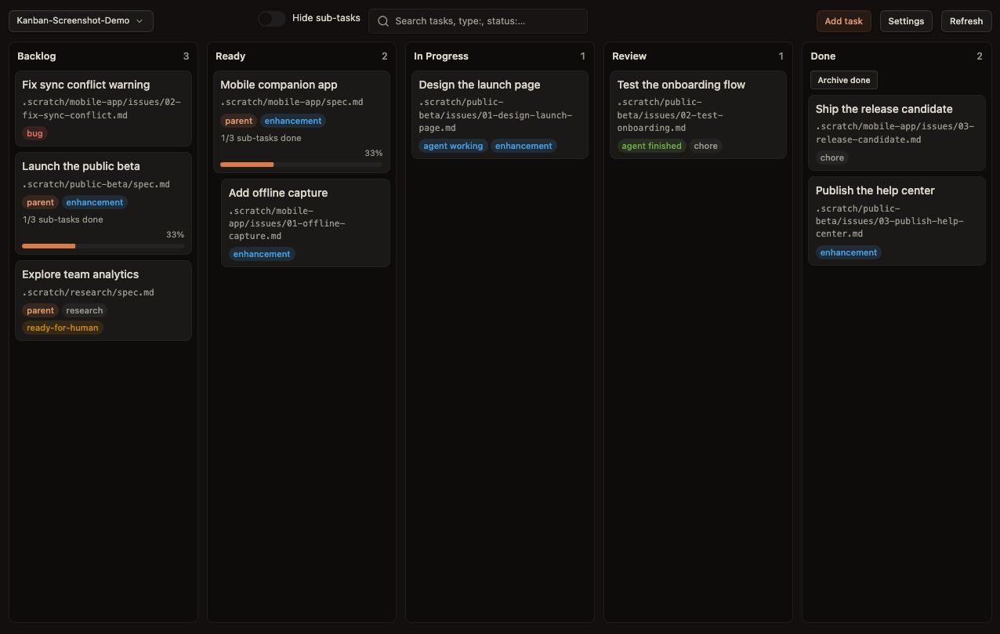

# Kanban Board for OpenChamber

Kanban Board is an [OpenChamber](https://github.com/openchamber/openchamber) extension that shows your project's tasks as a board and starts agent sessions on them. The tasks stay where they already are: Markdown files in the repository's `.scratch/` folder, GitHub Issues, or both. The board uses the task format of Matt Pocock's agent skills, so you, the board and your agents all edit the same files.

Requires OpenChamber 2.7.1 or later. MIT licence.



## Highlights

- **Local tasks next to GitHub Issues.** A project can keep private tasks in `.scratch/` and shared ones on GitHub, and see both on one board with a source switcher. **Publish to GitHub** turns a local task into an issue (sub-tasks become sub-issues). The board keeps no task data of its own; the tracker in your repository is the only copy.
- **Drag a card, an agent starts.** Dropping a card on In Progress starts a session in a new git worktree, with the card's preset, model, thinking level and agent. When the agent finishes or waits for you, the card moves to Review. A per-project limit queues the rest, and the queue keeps going while the board is closed.
- **Matt Pocock's skills or Superpowers.** Presets (Plan, Implement, Diagnose, Break down and orchestrate, and more) come in three sets: one for [Matt Pocock's skills](https://github.com/mattpocock/skills), one for [Superpowers](https://github.com/obra/superpowers), and one with plain instructions. By default the board uses the first set whose skills are all installed, in that order; you can switch and edit any of them.
- **Agents use the board too.** Four agent skills and a `task-board` CLI let agents create, claim and close tasks in the same format. A feature with sub-tasks gets one orchestrator session that hands the sub-tasks to subagents.

Also:

- Each card can show a short summary in your language, and new tasks get a type and state suggested by your Small Model.
- Every board action has a keyboard shortcut you can rebind; `?` shows them. Search takes filters such as `type:bug` and `state:needs-info`.
- Opened beside a chat, the panel shows the task that chat is working on. `/kanban` in the composer opens it.
- Settings, presets and summaries are stored per user in OpenChamber, never in the repository.

## Install

The repository is private for now, so install from a local clone:

1. Clone this repository somewhere outside the projects you will use the board on.
2. In OpenChamber, open **Settings → Extensions** and install from that folder. Inside a chat, a link with the folder's absolute path shows an install button: `openchamber://extensions/install?path=/absolute/path/to/ICF-OpenChamber-Kanban-board`
3. Approve the permissions OpenChamber lists. [docs/permissions.md](docs/permissions.md) explains each one.

Once the repository is public, you can install it from **Settings → Extensions** with the URL `https://github.com/krzeznicki/ICF-OpenChamber-Kanban-board` (or the link `openchamber://extensions/install?url=https://github.com/krzeznicki/ICF-OpenChamber-Kanban-board`), and OpenChamber will offer updates.

The board opens from the **Kanban Board** icon in the side rail (), or full screen from the sidebar's Extension pages menu.

## Quick start

1. Open a project. If it has no `docs/agents/issue-tracker.md`, the board asks where tasks should live: **Local** (`.scratch/` files) or **GitHub** (Issues, needs `gh` 2.94 or later).
2. Press **Add task**, give it a title and a description, and leave Type and State on **Let the model pick**.
3. Drag the card to **Ready** once it is clear enough for an agent.
4. Drag it to **In Progress**. An agent session starts in its own worktree; **Open session** in the card's modal takes you there.
5. When the card reaches **Review**, check the work and drag it to **Done**.

## How the columns map to the tracker

| Column | Local file | GitHub |
|---|---|---|
| Backlog | `Status: needs-triage`, `needs-info`, `ready-for-human`, `wontfix` or none | the same labels, or none |
| Ready | `Status: ready-for-agent` | label `ready-for-agent` |
| In Progress | a session started from the card is running, or the card is queued | the same |
| Review | that session finished, or waits for a permission or an answer | the same |
| Done | `Status: resolved` | issue closed |

In Progress and Review are never written to the repository ([full rules](docs/board.md)). Moving a card between the other columns changes one line of the task file, or swaps a label (or closes the issue) on GitHub.

## Documentation

- [The board](docs/board.md): cards, the task modal, sub-tasks, sources, search, archiving and summaries.
- [Agents](docs/sessions.md): how sessions start, presets and preset sets, the queue, known limits.
- [Settings](docs/settings.md): the three settings layers, sources, model and agent pickers, defaults.
- [Keyboard shortcuts](docs/keyboard.md)
- [Agent skills and the `task-board` CLI](docs/cli.md)
- [Permissions and stored data](docs/permissions.md)
- [Development](docs/development.md): building, testing a branch with the Kanban TEST build, release checks.
- [Changelog](CHANGELOG.md)

## Roadmap

- More task sources: Linear, Jira, Asana and ClickUp, each connected through the tool's own MCP server or official CLI ([ADR 0001](docs/adr/0001-several-sources-one-primary.md)).
- A public repository, so the board installs and updates from its git URL.
- The manual checks listed in [docs/development.md](docs/development.md) before the first public release.

## Development

```sh
npm install
npm run check   # typecheck, tests and build
```

The built files are committed, because OpenChamber does not build on install. See [docs/development.md](docs/development.md).

## Licence

MIT. Bundled third-party licences are in [THIRD_PARTY_LICENSES](THIRD_PARTY_LICENSES).
