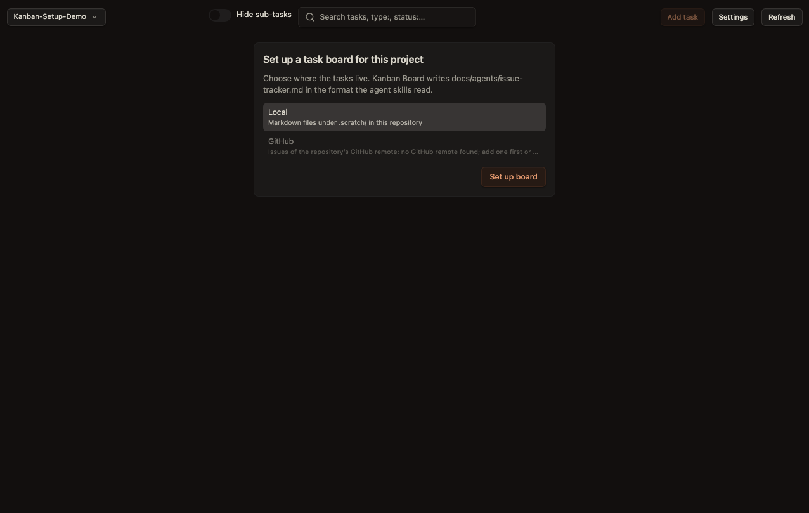
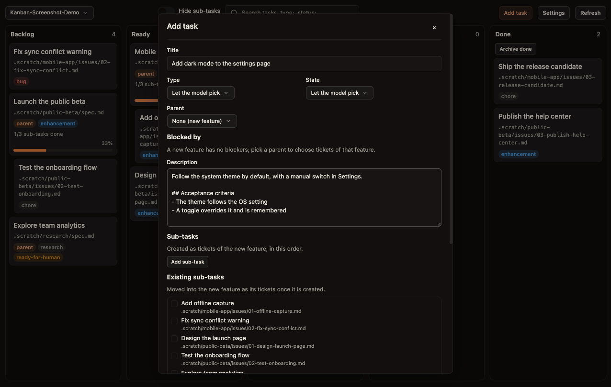
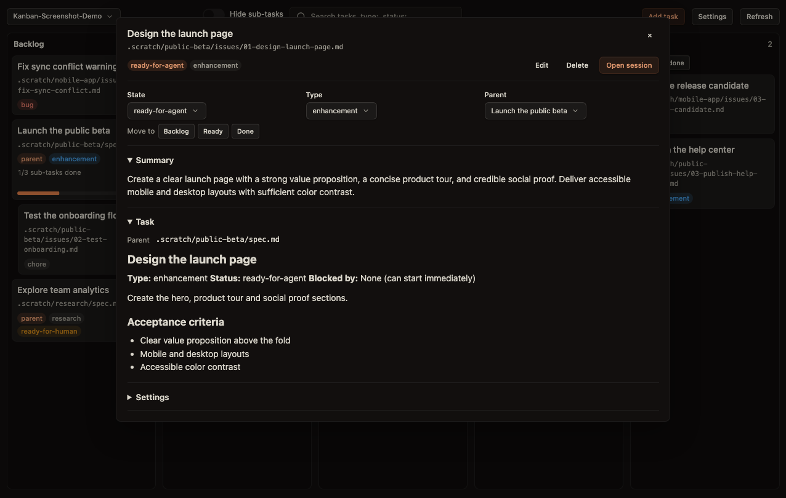
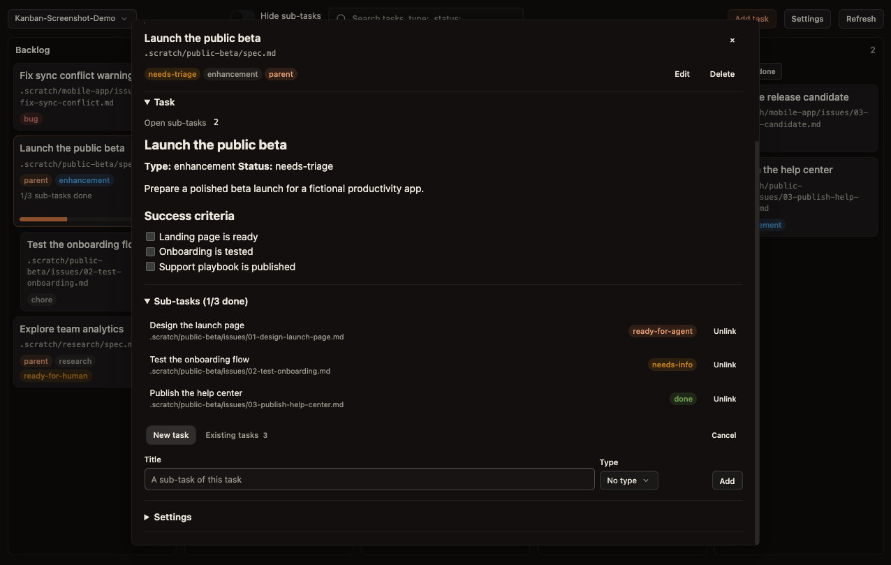
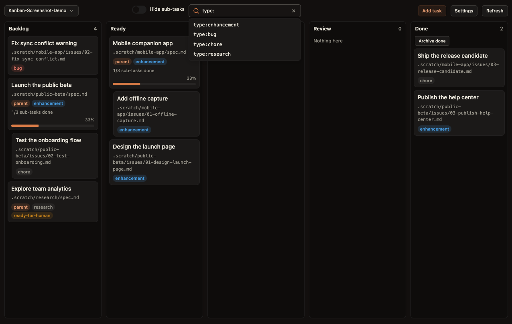

# The board

The board has five columns: Backlog, Ready, In Progress, Review and Done. Backlog, Ready and Done come from the task's state in the tracker. In Progress and Review come from the agent session linked to the card and are never written to the repository, because Matt Pocock's format has no such states.

| Column | Local file | GitHub | Dropping a card here |
|---|---|---|---|
| Backlog | `Status:` `needs-triage`, `needs-info`, `ready-for-human`, `wontfix` or none | the same labels, or no state label | sets `needs-triage` |
| Ready | `Status: ready-for-agent` | label `ready-for-agent` | sets `ready-for-agent` |
| In Progress | a linked session is running, or the card is queued or starting | the same | starts an agent, or queues it |
| Review | the linked session finished, or waits for a permission or an answer | the same | not allowed |
| Done | `Status: resolved` | issue closed | closes the task |

Done shows tasks finished in the last 30 days.

## Trackers and sources

The board reads `docs/agents/issue-tracker.md`, the file Matt Pocock's `setup-matt-pocock-skills` writes. When a project has none, the board offers to write it:

- **Local** keeps tasks as Markdown in the repository. A feature is `.scratch/<feature>/spec.md` and its tickets are `.scratch/<feature>/issues/NN-slug.md`. Each file carries `**Status:**`, `**Blocked by:**` and an optional `**Type:**` line.
- **GitHub** uses the repository's Issues. It needs a github.com remote and `gh` 2.94 or later, logged in. The board creates the state labels and the `bug` and `enhancement` labels the repository lacks. Parents are issues with sub-issues, and blockers are GitHub issue dependencies.

An existing `issue-tracker.md` is never overwritten. If the project already uses Matt's skills, the board reads their files as they are, including custom label names in `docs/agents/triage-labels.md`.

A project can have several sources, for example private local tasks and public GitHub Issues. One of them is the primary source, where new tasks go unless you pick another. The others are listed under `## Additional sources` in `issue-tracker.md`. A sub-task, its parent and its blockers always live in the same source, so a public issue never points at a private file. Add and remove sources, or change the primary one, in [Settings → Sources](settings.md#sources).

With several sources, a switcher next to the project switcher shows **All**, **Local** or **GitHub**, and each card in All carries a source badge. If one source fails to load (for example `gh` is logged out), the others still show, with a banner and **Try again** for the failing one.

**Publish to GitHub** in a local task's modal creates a GitHub issue from it, with sub-tasks as sub-issues and the state label carried over, then closes the local files with a link to the issue. If GitHub fails part way, the board names the issues it already created and leaves the local files open.

## Types

The default types are `enhancement`, `bug`, `chore` and `research`; edit the list in Settings. Locally a type is the `**Type:**` line; on GitHub it is the `bug` or `enhancement` label, or a `type:<name>` label for the others. A task's type picks its default preset when it starts (see [Agents](sessions.md#which-preset-a-card-gets)).

## Moving cards

Drag a card to another column, or use **Move to** in its modal. A move shows at once; the write to the tracker runs in the background, and the card goes back with an error if it fails.

- Only one line of the task file changes (locally), or one state label (GitHub).
- Dragging a card out of In Progress or Review back to Backlog or Ready detaches it from its session. The session keeps running; open it from the session list.
- To start a Done card again, move it to Backlog or Ready first.
- `ready-for-human` and `wontfix` show as badges on Backlog cards. A claimed ticket (`Status: claimed` locally, an assignee on GitHub) counts as `ready-for-agent`.

### Working on several cards

**⌘-click** (Ctrl-click outside macOS) marks a card, and **Shift-click** marks every card between the last marked one and the clicked one, across columns, as in a file list. A plain click, a click on the board's background or Escape clears the marks.

Dragging a marked card moves every marked card to that column, and ⇧⌘← / ⇧⌘→ moves them one column on. A group only moves between columns; it does not reorder or link cards. Cards that cannot go there stay, with the reason given once. Parents with open sub-tasks ask one at a time, and starts respect the agent limit and the queue.

Marked cards also bring up a floating action panel:

- **State** and **Type**, then **Apply**. For `done`, **Close sub-tasks** (on by default) closes the whole tree under each task.
- **Move to column**, **Set parent**, **Unlink parent** and **Add blocker**. Local blockers must be tickets of the same feature.
- **Labels**, for GitHub tasks only.
- **Start Task**, which uses each card's own start options and joins the queue when no slot is free.
- **Archive** and **Restore** for done tasks, **Copy** (titles, or links and local paths) and **Delete**, after a separate confirm.

Each form says how many marked tasks it applies to and why the others are left out. If some tasks fail, they stay marked so you can retry; values already saved are skipped.

Drag a card up or down its own column to reorder it. The order is kept by the board, not in the repository; cards you never reordered follow the tracker's order below the others.

Dropping a card onto the middle of another card makes it that card's sub-task, after a confirm. The top and bottom edges of a card still reorder.

## Adding tasks

**Add task** opens a form with the title, type, state, parent, the tasks it is blocked by, a Markdown description, the card's start options and a list of sub-tasks to create with it. You can also pick existing tasks to move under the new one. With several sources, a **Source** select chooses where the task goes.

Locally a task without a parent is a feature (`spec.md`), and a task with a parent is a ticket in that feature. Blockers can only be tickets of the same feature. On GitHub any open issue can be a parent or a blocker.

If some sub-tasks fail to be created, the form names them and the reason; the main task stays. Closing a form you have filled in asks **Discard this task?** first.

### Type and state from your Small Model

Type and State start on **Let the model pick**. The task is created as `needs-triage` with no type, then the board sends the title and description to OpenChamber's Small Model and asks for a type and a state. The model picks `research` for a task that is not described well enough to implement. The answer is written only to fields you left to the model and have not changed since; anything malformed is ignored.

Tasks made elsewhere (by the CLI, an agent or on GitHub) without a type get one the same way when their summary is generated. A type you set yourself is never replaced. If no Small Model is set, the board says so once and stops offering the option. Turn it off with **Settings → Global → Suggest type and state for new tasks**.

## The task modal

A click on a card, or Enter on the selected card, opens the task. From top to bottom:

- **Header**: title, id, state and type badges. **Open session** opens the task's agent session if it has one that is not archived; otherwise the header says **Session archived** or **Session not listed in OpenChamber**. **Edit** turns the task into a title and description form. **Delete** removes the task for good after a confirm.
- **State, Type, Parent and Move to**: change the state, type or parent, or move the card to a column. On a local task, **Publish to GitHub** sits at the end of this row. A GitHub task shows **Open on GitHub ↗** under its title.
- **Summary**: the card's summary, or a **Summarise** button.
- **Task**: the description as formatted Markdown. Raw HTML is shown as text, images are shown as links, and only `http` and `https` links open.
- **Sub-tasks**: the children with their states. **Add sub-task** creates new ones or links existing tasks; **Unlink** removes one from this parent.
- **Settings** (collapsed): this card's start options.

**Edit** saves only the fields you changed, and refuses if an agent changed them since you opened the form; your text stays in the form so you can copy it. Locally the file name and the id stay the same.

**Delete** removes a local task's file (a feature with its whole folder), or runs `gh issue delete` on GitHub, which only repository admins may do. On GitHub you choose whether sub-issues are deleted too or kept as top-level issues.

Changing a local ticket's parent moves its file, so the task gets a new id. Its session link, queued start and start options follow it.

## Parents and orchestration

A parent is a task with sub-tasks. Its card shows progress (`2/5 sub-tasks done`), and sub-tasks are drawn indented under it when both are in the same column. **Hide sub-tasks** in the toolbar hides them.

Dragging a parent with sub-tasks to In Progress starts one orchestrator session with the **Break down and orchestrate** preset. The orchestrator claims each sub-task through the CLI and hands it to a subagent. While it runs, its sub-tasks show **led by orchestrator**, and dropping one of them on In Progress starts nothing. A parent without sub-tasks starts with its type's preset; choose Break down and orchestrate on the card to have it split into sub-tasks first.

Moving a parent with open sub-tasks to Done asks whether to close them too.

## Search

**Search tasks** in the toolbar keeps the cards whose title or description contains every word you type, ignoring case and accents. A matching sub-task keeps its parent on the board.

The field also takes filters, with `:` or `=`:

| Filter | Matches |
|---|---|
| `type:bug` | the task's type |
| `state:info` | the tracker state (`needs-info`) |
| `column:prog` | the board column (In Progress) |
| `status:ready` | the column if the value names one, otherwise the state |
| `source:github` | the source (only with several sources) |

A value matches from the start of any of its words. The same key twice means either (`type:bug type:research`); everything else must all match. A list under the field completes keys and values as you type. Escape clears the search.

## Archiving done tasks

**Archive done** in the Done column header hides every done task from the board, after a confirm. Nothing changes in the repository. **Show archived** shows them again, greyed out, and their modal has **Unarchive**. A task that is reopened leaves the archive by itself, and a parent's progress still counts its archived sub-tasks.

**Clear archive** deletes every archived task for good, as **Delete** does in the task modal.

## Summaries

Each card can show two to four plain sentences about the task, written by your model through OpenChamber. Summaries are personal: they are stored in OpenChamber, never in the repository, and agents do not see them. A summary is written again when the task's description, the language or the prompt changes.

Settings control whether summaries are written automatically, in which language, and with which prompt. The language can also be set per card. With automatic summaries off, use **Summarise** in the task modal.

## The panel beside a chat

Opened from the rail beside a chat, the board shows what that chat is working on:

- one task: its modal opens;
- several tasks: a **Tasks in this session** list;
- none: a banner saying no task on the board is worked on in this session.

A task counts when the session was started from its card, unless the card was dragged back to Backlog or Ready afterwards. When the chat runs in a worktree, the board shows the project that worktree belongs to. Otherwise it opens on the last project you used.
