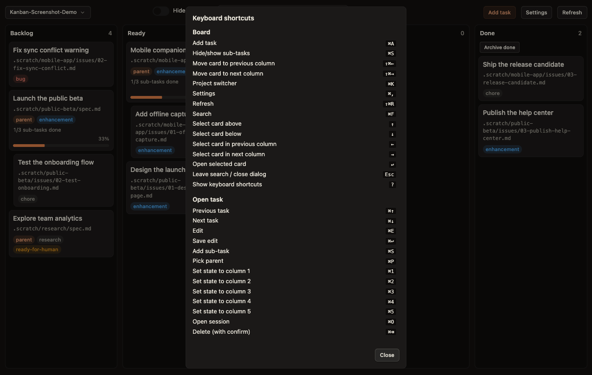

# Keyboard shortcuts

⌘ is Ctrl outside macOS. Press `?` on the board to see the shortcuts currently in use; button tooltips show them too. The ⌘ shortcuts can be given other keys in **Settings → Global → Keyboard shortcuts**; the arrows, Enter, Esc and `?` are fixed. A new key must use ⌘ and must not be taken in the same Shortcut context. The contexts are the Board, an Open task and Add task, and the same key can do different things in each.

## Board

| Key | Action |
|---|---|
| ↑ ↓ ← → | Select a card |
| Enter | Open the selected card |
| ⇧⌘← / ⇧⌘→ | Move the selected card to the previous or next column |
| ⌘A | Add task |
| ⌘S | Hide or show sub-tasks |
| ⌘K | Project switcher |
| ⌘, | Settings |
| ⇧⌘R | Refresh the board |
| ⌘F | Search |
| Esc | Leave search, close a dialog |
| ? | Show the shortcuts |

In the search field, ↓ selects the first matching card.

## Open task

| Key | Action |
|---|---|
| ⌘↑ / ⌘↓ | Previous or next task in the column |
| ⌘E | Edit |
| ⌘Enter | Save the edit |
| ⌘S | Add sub-task |
| ⌘P | Pick parent |
| ⌘1 … ⌘5 | Move to column 1 to 5 |
| ⌘O | Open session |
| ⌘⌫ | Delete, after a confirm |

## Add task

| Key | Action |
|---|---|
| ⌘Enter | Create the task |

In text fields, ⌘A, the arrows and ⌘⌫ keep their usual meaning.

## In the chat

`/kanban` in OpenChamber's chat composer opens the board panel.
